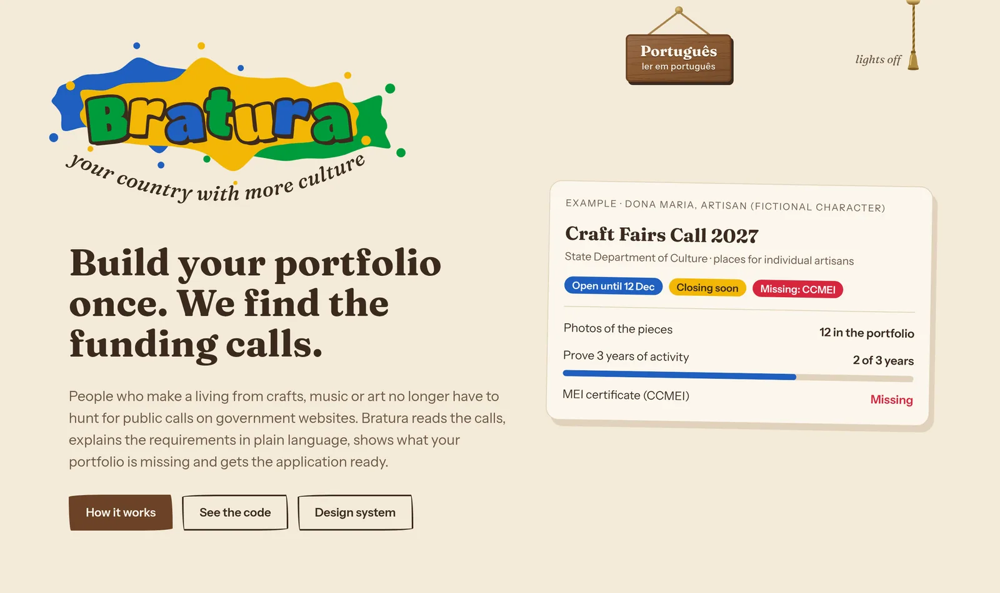
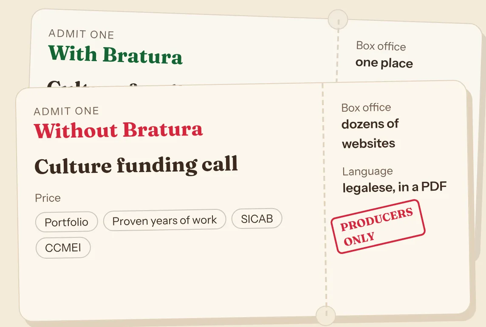
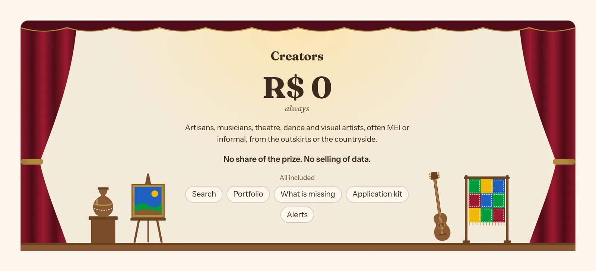

<a href="https://bratura.vercel.app/en">
  <picture>
    <source media="(prefers-color-scheme: dark)" srcset="docs/readme/hero-dark.webp">
    
  </picture>
</a>

# Bratura

> **Monte seu portfólio uma vez. A gente encontra as oportunidades, diz o que falta e prepara sua inscrição.**<br>
> *Build your portfolio once. We find the funding calls, say what is missing and get the application ready.*

A copilot for the people who make Brazil's culture by hand: artisans, musicians, theatre, dance and
visual artists, many of them MEI or informal, from the outskirts and the countryside. They build a
portfolio once; Bratura finds the public calls (*editais*), festivals and fairs that fit them,
explains each one in plain Portuguese, shows what is missing and prepares the application.

**[See it live](https://bratura.vercel.app/)** · [in English](https://bratura.vercel.app/en) ·
[design system](https://bratura.vercel.app/design) · [manifesto](MANIFEST.md)

Hack Brasil 2026 · track **Cultura & economia criativa**

---

## The ticket only producers can buy

<a href="https://bratura.vercel.app/en#por-que">
  <picture>
    <source media="(prefers-color-scheme: dark)" srcset="docs/readme/tickets-dark.webp">
    
  </picture>
</a>

The money for culture exists. The road to it is the hard part.

Calls are scattered across dozens of websites, written in legal language inside PDFs, and ask for
things many people do not have: a portfolio, proof of years of work, an artisan registration
(SICAB), a MEI certificate (CCMEI).

Those who can pay a producer apply. Those who cannot miss the deadline, or are disqualified over
one document. Bratura is the same ticket, with the way to each document.

<br clear="right">

## Four rooms, from portfolio to application

| | | |
|---|---|---|
| **Room 1** | **Your portfolio** | Photos, links, documents or audio, told whatever way is easiest. The AI arranges them into a dated timeline, and every activity keeps its proof. |
| **Room 2** | **The right calls** | The portfolio is the profile, matched against open calls, festivals and fairs: *eligible*, *almost eligible* or *not eligible*, always with the reason. |
| **Room 3** | **What is missing** | Amount, deadline, who can apply and which documents, in plain language. Missing a SICAB or a CCMEI? Bratura shows where and how to get it. |
| **Room 4** | **Ready to apply** | The portfolio in the format each call asks for, texts suggested only from the creator's own work, the document checklist, and a reminder by e-mail and Telegram before the deadline. |

### Nothing is made up

Every amount, deadline and requirement comes from an official source, with the link. The AI reads,
summarizes and suggests; it never invents a fact about a call. When the source does not say,
Bratura says *"não informado"*.

## The stage belongs to creators. The audience buys the tickets.

<a href="https://bratura.vercel.app/en#modelo-de-negocio">
  <picture>
    <source media="(prefers-color-scheme: dark)" srcset="docs/readme/theatre-dark.webp">
    
  </picture>
</a>

Bratura runs on a **Freemium Impact** model—never taking a percentage of prize money or selling
creators' personal data. Essential access is always free so independent artists and artisans can
build their portfolio and find where they qualify; revenue comes from advanced application workflows
and from organizations serving multiple creators or distributing cultural funds:

| Seat | Who | How they pay |
|---|---|---|
| **General admission · Free** | Independent creators and beginners | **R$ 0, always:** guided portfolio, eligibility radar, document checklists and local calls |
| **Front row · Freemium Pro** | Active artists and independent producers | **Pay-per-call** (on-demand application kit) or **Pro subscription** for unlimited call adaptations and post-award checklists |
| **Row A · Main B2B revenue** | Associations, cooperatives and production houses | **Monthly/annual subscription** per managed portfolio tier, with a multi-profile panel to submit and track many creators at once |
| **Row B · B2G expansion** | City culture departments and public bodies | **Annual contract:** fuller applications, fewer disqualified ones, and a live map of local cultural demand |
| **Box seats · Phase 2** | Sponsoring companies and post-award partners | **Subscription** to match verified projects for tax-incentive laws (Rouanet / ProAC), plus opt-in referrals (MEI accounting, business accounts) after selection |

## Where the calls come from

Only open sources that allow automated access, with robots.txt and terms checked one by one.

| Source | How |
|---|---|
| 33 Mapas Culturais instances: federal, states and cities | Public JSON API |
| 95 official pages of culture departments, foundations and public bodies | Plain fetch; Firecrawl from Brazil for pages that answer only there |
| The call notices' PDFs and annexes | Firecrawl, or the PDF's own text layer when Firecrawl answers nearly empty |
| The creator's portfolio | What the creator enters; in the demo it stays in the browser |

34 more sources were checked and stay off, the reason written beside each one (terms, timeouts, a
reader still missing) in [`registry.ts`](packages/backend/convex/model/sources/registry.ts).

Left out on purpose: platforms whose terms forbid extraction (Prosas, social networks), sources that
block crawlers, and anything that exposes personal data. The demo stars a **fictional** creator,
Dona Maria.

## How it is built

**Live today**, in Portuguese and English, on real calls read from official sources: the landing
page, sign-in and sign-up as a browser demo, the portfolio, the call lists (*eligible*, *almost*,
*all*) and each call's requirements crossed with the portfolio, plus the design system and its
`/design` reference. Behind them, the Convex backend: ingestion, extraction, matching, the
notification outbox with Telegram delivery, and AbacatePay billing for the organization panel.
**Next:** the application kit, real sign-in with WorkOS, the creator plans, the Telegram bot that
answers, e-mail alerts.

```
 Web (Next.js) ───┐                       ┌── Mapas Culturais APIs
 Telegram ────────┼──►  Convex backend  ◄─┼── official pages and PDFs (Firecrawl)
 E-mail (Resend) ─┘   ingestion · extraction · matching · alerts · billing
                      database · cron · HTTP actions (webhooks)
 Login: WorkOS         LLM: Gemini API, behind a swappable adapter
 Billing: AbacatePay
```

- **Ingestion**: each source's listing on a schedule; reading each PDF and extracting it run in
  batches under a credit ceiling. The LLM classifies a document (a real call for creators or an
  admin form?) and extracts the requirements as Zod-validated JSON with a verbatim quote for every
  value, checked against the text: a value without its quote is dropped.
- **Matching is rules, not guesses:** region, applicant type, art form, deadline, age, MEI, SICAB,
  CCMEI. The LLM only reads the calls; the backend computes, the web displays.
- **Telegram is not a separate service:** alerts leave through an outbox in Convex (one row per
  delivery, retries, opt-out when the bot is blocked); what triggers them and the bot that answers
  come next.

| Layer | Tech |
|---|---|
| Web | Next.js (App Router), TypeScript, Tailwind CSS 4, Vercel |
| Backend and database | Convex: queries, mutations, actions, cron, HTTP actions |
| Auth · e-mail · messaging | WorkOS AuthKit (next) · Resend (next) · Telegram Bot API |
| Billing | AbacatePay: hosted checkout, signed webhooks |
| Crawling · AI | Firecrawl · Gemini API, through an OpenAI-format adapter |
| Contract | Zod: one schema per concept, shared by web and backend |

### Repository map

```
apps/web/             Next.js: src/app routes, src/features holds one folder per screen
packages/ui/          @bratura/ui, the design system (its living reference is /design)
packages/shared/      the contract: Zod entities and primitives for web and backend
packages/backend/     Convex: schema, ingestion, extraction, matching, alerts, Telegram, billing
docs/                 architecture, contracts, security, data sources, integrations, the plan to 30/11
docs/review.md        the checklist every change is reviewed against
```

Each folder has an `AGENTS.md` with its rules and examples, for people and coding agents alike; the
root [`AGENTS.md`](AGENTS.md) lists them.

## Run it

Node 22 and pnpm.

```bash
pnpm install
pnpm dev        # http://localhost:3000, Portuguese at / and English at /en
pnpm check      # lint, typecheck, tests and build: what CI runs
```

The backend runs on Convex ([`packages/backend/AGENTS.md`](packages/backend/AGENTS.md)); its keys
(Firecrawl, Gemini, Telegram, AbacatePay) live in the Convex deployment, the web's in Vercel
([`apps/web/.env.example`](apps/web/.env.example)). Never in the repo.

## Other ways to visit: accessibility

Planned after the essentials, if the deadline allows:

- **Libras** with [VLibras](https://www.gov.br/governodigital/pt-br/vlibras), the federal
  government's free, open-source widget: an avatar signs the text the reader selects. Loaded only
  on Portuguese pages, and only when asked for.
- **Listen:** a button on each part that matters reads it aloud with the device's own voice (Web
  Speech API), for people who see the page but find reading hard. No cost, nothing to install.
- **Telegram** as a second way in: one backend, two doors (the site and Telegram). For someone
  already signed up with a portfolio: the alert of a new call they are eligible for, what is
  missing and the deadline, in an app they already use. The delivery is built; what triggers each
  alert and the bot that answers come next.

## Team

| Who | Role | Focus |
|---|---|---|
| **Atilio Almeida** | Product owner | The idea, product insights, research inputs, business model and monetization |
| **João Victor** | Tech lead | Repository foundation (front-end patterns, the contract, the tools we use), ingestion and extraction, the data |
| **Leandro** | Front end | Sign-in, portfolio, call screens and matching, the landing |
| **Kaik** | Integrations developer | Telegram alerts, AbacatePay billing, sign-in |

Authorship, originality and the use of AI are in the [manifesto](MANIFEST.md).

## License

[MIT](LICENSE)
