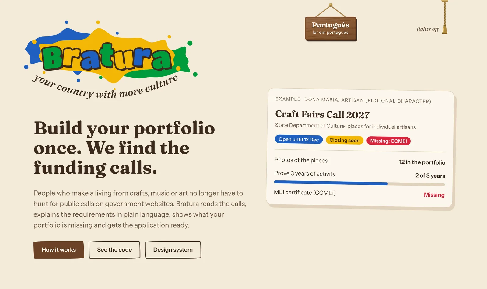
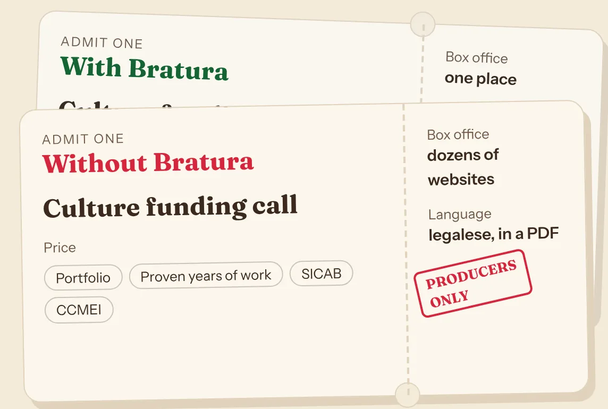
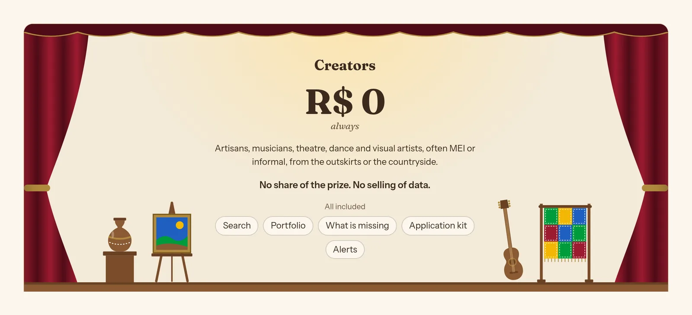

<a href="https://bratura.vercel.app/en">
  <picture>
    <source media="(prefers-color-scheme: dark)" srcset="docs/readme/hero-dark.webp">
    
  </picture>
</a>

# Bratura

> **Monte seu portfólio uma vez. A gente encontra as oportunidades, diz o que falta e prepara sua inscrição.**<br>
> *Build your portfolio once. We find the funding calls, say what is missing and get the application ready.*

A copilot for the people who make Brazil's culture by hand: artisans, musicians, theatre, dance and
visual artists, many of them MEI or informal, from the outskirts and the countryside. They build a
portfolio once; Bratura finds the public calls (*editais*), festivals and fairs that fit them,
explains each one in plain Portuguese, shows what is missing and prepares the application.

**[See it live](https://bratura.vercel.app/)** · [in English](https://bratura.vercel.app/en) ·
[design system](https://bratura.vercel.app/design) · [manifesto](MANIFEST.md)

Hack Brasil 2026 · track **Cultura & economia criativa**

---

## The ticket only producers can buy

<a href="https://bratura.vercel.app/en#por-que">
  <picture>
    <source media="(prefers-color-scheme: dark)" srcset="docs/readme/tickets-dark.webp">
    
  </picture>
</a>

The money for culture exists. The road to it is the hard part.

Calls are scattered across dozens of websites, written in legal language inside PDFs, and ask for
things many people do not have: a portfolio, proof of years of work, an artisan registration
(SICAB), a MEI certificate (CCMEI).

Those who can pay a producer apply. Those who cannot miss the deadline, or are disqualified over
one document. Bratura is the same ticket, with the way to each document.

<br clear="right">

## Four rooms, from portfolio to application

| | | |
|---|---|---|
| **Room 1** | **Your portfolio** | Photos, links, documents or audio, told whatever way is easiest. The AI arranges them into a dated timeline, and every activity keeps its proof. |
| **Room 2** | **The right calls** | The portfolio is the profile, matched against open calls, festivals and fairs: *eligible*, *almost eligible* or *not eligible*, always with the reason. |
| **Room 3** | **What is missing** | Amount, deadline, who can apply and which documents, in plain language. Missing a SICAB or a CCMEI? Bratura shows where and how to get it. |
| **Room 4** | **Ready to apply** | The portfolio in the format each call asks for, texts suggested only from the creator's own work, the document checklist, and a reminder by e-mail and WhatsApp before the deadline. |

### Nothing is made up

Every amount, deadline and requirement comes from an official source, with the link. The AI reads,
summarizes and suggests; it never invents a fact about a call. When the source does not say,
Bratura says *"não informado"*.

## The stage belongs to creators. The audience buys the tickets.

<a href="https://bratura.vercel.app/en#modelo-de-negocio">
  <picture>
    <source media="(prefers-color-scheme: dark)" srcset="docs/readme/theatre-dark.webp">
    
  </picture>
</a>

Creators never pay, for anything. The bill goes to those who serve many creators or distribute the
money for culture, because they win when more people apply properly:

| Seat | Who | How they pay |
|---|---|---|
| Row A · main revenue | Associations, cooperatives and producers | Per managed profile, for a panel that follows many creators at once |
| Row B · expansion | City culture departments | Annual contract: fuller applications, fewer disqualified ones, a map of cultural demand |
| Box seats · phase 2 | Sponsoring companies | Subscription, to find organized projects for the Rouanet law or ProAC |

## Where the calls come from

Only open sources that allow automated access, with robots.txt and terms checked one by one.

| Source | How |
|---|---|
| Mapas Culturais: federal, Ceará, Pernambuco, Santo André, Canindé | Public JSON API |
| The edital PDFs those APIs link to | Firecrawl |
| São Paulo city culture calls · Amigos da Arte (SP state) · Goiás craft fairs | Firecrawl |
| The creator's own uploads | Convex storage, with consent |

Left out on purpose: platforms whose terms forbid extraction (Prosas, social networks), sources that
block crawlers, and anything that exposes personal data. The demo stars a **fictional** creator,
Dona Maria.

## How it is built

**Live today:** the landing page in Portuguese and English, the design system and its `/design`
reference, CI. **Being built for the hackathon:** the Convex backend (ingestion, portfolio,
matching, alerts) and the app screens.

```
 Web (Next.js) ───┐                       ┌── Mapas Culturais APIs
 WhatsApp ────────┼──►  Convex backend  ◄─┼── official pages and PDFs (Firecrawl)
 E-mail (Resend) ─┘   ingestion · portfolio · matching · alerts
                      database · cron · vector search · file storage
 Login: WorkOS         LLM: Gemini API, free tier, behind a swappable adapter
```

- **Ingestion**, on a schedule: fetch the calls, read each PDF, let the LLM classify it (a real
  opportunity or an admin form?) and extract the requirements as Zod-validated JSON with a verbatim
  quote for every field, then store them with the source link and an embedding.
- **Matching is rules, not guesses:** region, applicant type, art form, deadline, MEI, SICAB,
  CCMEI. The LLM reads PDFs, organizes portfolios and drafts texts; the backend computes, the web
  displays.
- **WhatsApp is not a separate service:** its webhook is a Convex HTTP action sharing the web app's
  logic.

| Layer | Tech |
|---|---|
| Web | Next.js (App Router), TypeScript, Tailwind CSS 4, Vercel |
| Backend and database | Convex: queries, mutations, actions, cron, vector index, file storage, HTTP actions |
| Auth · e-mail · messaging | WorkOS AuthKit · Resend · WhatsApp Cloud API |
| Crawling · AI | Firecrawl · Gemini API (free tier) |
| Contract | Zod: one schema per concept, shared by web and backend |

### Repository map

```
apps/web/             Next.js: src/app routes, src/features holds one folder per screen
packages/ui/          @bratura/ui, the design system (its living reference is /design)
packages/shared/      the contract: Zod entities and primitives for web and backend
packages/backend/     next: Convex schema, ingestion, portfolio, matching, alerts, WhatsApp
docs/architecture.md  how the pieces fit, and why
docs/review.md        the checklist every change is reviewed against
```

Each folder has an `AGENTS.md` with its rules and examples, for people and coding agents alike; the
root [`AGENTS.md`](AGENTS.md) lists them.

## Run it

Node 22 and pnpm.

```bash
pnpm install
pnpm dev        # http://localhost:3000, Portuguese at / and English at /en
pnpm check      # lint, typecheck, tests and build: what CI runs
```

The backend will add a Convex deployment and keys for WorkOS, Firecrawl, Resend, Gemini and the
WhatsApp Cloud API, with a `.env.example` to copy. Keys live in Convex and Vercel, never in the repo.

## Next rooms: accessibility

Planned after the essentials, if the deadline allows:

- **Libras** with [VLibras](https://www.gov.br/governodigital/pt-br/vlibras), the federal
  government's free, open-source widget: an avatar signs the text the reader selects. Loaded only
  on Portuguese pages, and only when asked for.
- **Listen:** a button on each part that matters reads it aloud with the device's own voice (Web
  Speech API), for people who see the page but find reading hard. No cost, nothing to install.

## Team

**Atilio Almeida** (idea and product lead), **Leandro**, **Kaik** and **João Victor**. Authorship,
originality and the use of AI are in the [manifesto](MANIFEST.md).

## License

[MIT](LICENSE)
